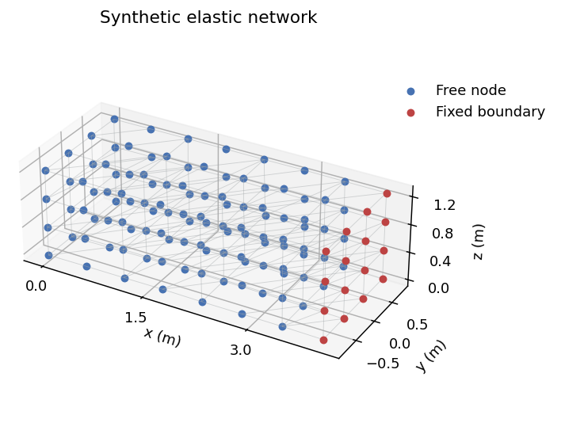
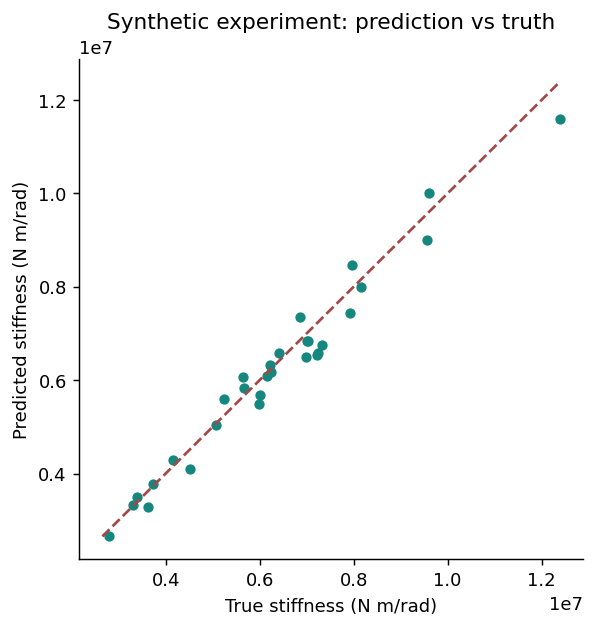
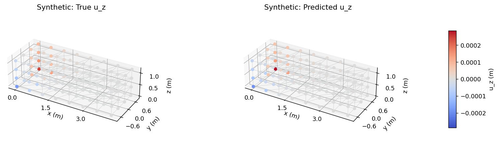

# AI-CAE GNN Surrogate Modeling

**Synthetic structural graph surrogate modeling and torsional-stiffness design screening.**

> This repository contains only synthetic data. No proprietary automotive geometry,
> finite-element model, material database, solver results, or company information is included.
>
> 本项目所有数据均为合成数据，仅用于技术路线验证和工程架构展示，不包含任何真实企业数据、车型数据或商业机密。

项目源于车身 CAE 设计迭代中的重复求解问题，复现参数基线、图代理模型、多任务
学习及候选筛选流程。它是个人研究原型。合成标量弹性网络不等同于壳梁 FEM，
OptiStruct 接口是未实现的扩展点。所有指标均为 **Synthetic Experiment**。



## Workflow

```mermaid
flowchart LR
  A[Synthetic Design] --> B[Frame or Mesh Graph]
  B --> C[Synthetic Elastic Solver]
  C --> D[Stiffness and Displacement]
  D --> E[Train / ID / OOD Dataset]
  E --> F[Baselines and GNN]
  F --> G[Multi-task and Physics Consistency]
  G --> H[Candidate Top-K Screening]
  H --> I[Synthetic Validation]
  I --> J[Future Authorized CAE Adapter]
```



## Quick Start

Python 3.10+; the executed demo used Python 3.12 and CPU PyTorch 2.6.0. No GPU,
commercial solver or private dataset is required. Run from the repository root:

```bash
python -m venv .venv
source .venv/bin/activate
python -m pip install torch==2.6.0 --index-url https://download.pytorch.org/whl/cpu
python -m pip install -r requirements.txt
python -m pytest -q
python scripts/run_experiments.py --config configs/demo.yaml
```

`run_experiments.py` generates all four splits, trains seven model configurations,
evaluates ID/OOD, screens 1000 designs, measures timing, and writes results. It replaces
the requested report directory; use `--report outputs/my-results` for a separate run.
Dependency versions of the executed run are recorded in `experiments/results/environment.json`.

Individual commands, verified in the current environment:

```bash
python scripts/generate_dataset.py --config configs/demo.yaml
python scripts/train_baseline.py --config configs/demo.yaml
python scripts/train_gcn.py --config configs/demo.yaml
python scripts/train_meshgraphnet.py --config configs/demo.yaml
python scripts/train_multitask.py --config configs/demo.yaml
python scripts/evaluate.py --checkpoint experiments/results/demo_physics.pt --split test
python scripts/design_screening.py --checkpoint experiments/results/demo_physics.pt --count 1000 --top-k 10
python scripts/benchmark_inference.py --checkpoint experiments/results/demo_physics.pt --count 100 --repeats 5
```

For multi-task training without physics, use:

```bash
python -m src.cli train --model multitask --config configs/demo.yaml
```

The larger `configs/dataset.yaml` uses 300/50/50/50 samples, hidden dimension 128,
6 processing steps and up to 100 epochs. That full budget was not executed here.
`configs/smoke.yaml` provides a small command-validation run.

## Executed Synthetic Results

Seed 42, 120/30/30/30 samples, 32 hidden dimensions, 3 processing steps, at most 30 epochs.

| Model | ID R² | ID MAPE | Thickness OOD R² |
|---|---:|---:|---:|
| Linear | 0.8913 | 8.70% | 0.7400 |
| Random Forest | 0.7502 | 13.62% | -0.8550 |
| MLP | 0.8668 | 9.14% | 0.7522 |
| GCN | 0.4996 | 15.66% | -1.2913 |
| MeshGraphNet-style | 0.9527 | 6.19% | 0.5752 |
| Multi-task | 0.9589 | 5.22% | 0.6273 |
| Multi-task + Physics | 0.9645 | 4.93% | 0.6478 |

Parameter baselines do not see the realized topology. This comparison includes an input
information difference. One seed and 30 ID test designs do not establish universal model superiority.
Physics improves stiffness error slightly in this run but does not improve ID displacement
RMSE or torque consistency. See the [ablation](experiments/ablation_study.md).

For 1000 independent synthetic candidates, Top-5/10/20 recall is **0.8/0.6/0.7**,
and Spearman correlation is **0.9871**. Ten solver calls validate selected designs;
990 additional calls provide the full-pool oracle audit required for recall.

The median timing for 100 designs is **0.0604 s synthetic solver vs 0.0737 s model inference**,
plus **0.0397 s graph construction**. The tiny synthetic solver is faster in this run.
**No OptiStruct speedup or industrial performance claim is made.**




## Architecture and Evidence

- [Detailed Chinese project report](docs/PROJECT_REPORT_CN.md): background, mathematics, design, limitations and future work.
- [Interview guide](docs/INTERVIEW_GUIDE_CN.md): 1/3/5-minute introductions and 38 questions with answers.
- [Real CAE migration guide](docs/REAL_CAE_MIGRATION_GUIDE_CN.md): parsing, authorization, large graphs and validation.
- [Data design](docs/DATA_DESIGN_CN.md), [model design](docs/MODEL_DESIGN_CN.md), [experiment design](docs/EXPERIMENT_DESIGN_CN.md).
- [Validation record](docs/VALIDATION_CN.md), [comparison CSV](experiments/results/comparison.csv), [raw metrics](experiments/results/metrics.json).
- [Graph architecture](assets/architecture.md), [notebooks](notebooks), [tests](tests).

`src/data` builds synthetic meshes and labels; `src/models` implements MLP, GCN and
MeshGraphNet; `src/losses` computes supervision and torque consistency;
`src/training` contains the experiment pipeline; `src/cae` isolates solver adapters.
Training-only normalization and exact zero boundary displacement are part of the model.
Checkpoints and PyG datasets use Python serialization: load only trusted project-generated files.

## Optional Active Learning

Train independently seeded models of the same architecture on the same data file,
then pass at least two checkpoints:

```bash
python experiments/train_ensemble_demo.py --config configs/demo.yaml
python experiments/active_learning_demo.py \
  --checkpoint outputs/ensemble/seed42/best.pt \
  --checkpoint outputs/ensemble/seed43/best.pt \
  --checkpoint outputs/ensemble/seed44/best.pt \
  --count 100 --queries 10
```

The script queries high-variance candidates and creates a new dataset with added training
graphs. Test splits remain fixed. Variance is an acquisition score, not a calibrated interval.
The optional acquisition was smoke-tested; no sample-efficiency gain is claimed.

## Scope

The solver is a sparse scalar spring network with nonlinear dependence on design parameters,
not shell/beam FEM. Only `u_z` is predicted. Physics loss enforces a global torque-angle relation,
not local equilibrium. Real automotive deployment needs authorized data, richer element features,
family-based splits, uncertainty calibration, large-graph methods and independent CAE verification.

License: [MIT](LICENSE).
