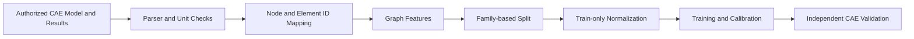

# 真实 CAE 迁移指南

本仓库只包含合成数据。以下为未来合法授权环境中的设计说明，未执行真实求解。

## 数据管道

必须先确定预测工况、测量规范与适用范围。扭转刚度的约束位置、加载位置、转角
测量点和单位不同，可能造成标签定义不一致。应记录工况版本和求解器设置，而不是
将结果文件中的某个数字直接作为通用刚度。数据应留在获准的企业环境中，公开
仓库使用独立合成示例，不发布节点坐标、零件命名或真实模型截图。

## 解析器契约

| 数据 | 必须核对的内容 |
|---|---|
| 节点 | 原始 ID、坐标、坐标系、单位、重复与孤立节点 |
| 单元 | ID、类型、连接、法向、局部方向及退化情况 |
| 材料 | 合法来源、单位、本构种类与适用状态 |
| 属性 | 厚度、截面、连接刚度、焊点与约束关系 |
| 工况 | 力、力矩、位移约束、加载方向与版本 |
| 结果 | 节点映射、位移自由度、收敛状态及异常值 |
| 样本 | 结构家族、网格版本、参数变化、求解版本 |

原始有限元节点编号通常不连续，不能直接当数组下标。解析器应建立显式 ID 到索引
映射，确保位移结果与图节点完全对应。壳单元、梁单元与连接件不能只按同一种边
处理；可使用单元节点二部图，或将不同关系定义为不同边类型。保留局部方向与
材料区域，避免丢失各向异性和截面信息。最初挑选少量样本进行人工及自动交叉核对。

## 求解器适配器

`BaseCAESolver.run(mesh)` 定义统一入口，当前合成实现返回刚度、位移、力矩、
转角和残差。真实适配器应拆分为模型导出、受控任务提交、状态轮询、日志检查、
结果解析和归档。任务失败、许可证不足、超时与非收敛必须成为显式状态，不能
返回正常标签。仓库中的 `OptiStructAdapter` 只抛出 `NotImplementedError`，没有
任何企业命令或路径，也没有伪造成功输出。

接口输入示例可以沿用合成网格、材料属性与边界定义；接口输出示例为
`SolverResult(stiffness, displacement, torque, angle, relative_residual, provenance)`。
真实数据的 `provenance` 必须反映其授权来源，不能仍标记 synthetic-only。
真实与合成数据应使用不同的数据管道与存储目录，避免混用当前的来源校验。

## 数据划分与质量

应按车型平台、基础结构或设计家族划分，而不是随机拆分相邻优化步骤。相同结构
的重复网格、相近参数变体以及多个工况可能造成隐藏泄漏。建立固定测试集，检查
训练与测试之间的近重复、单位变化、求解器版本变化和载荷定义变化。
归一化只从训练集拟合，并在部署时使用相同统计量。

质量检查覆盖几何、连接、材料、边界、载荷和响应。核对载荷合力及力矩、约束
自由度和刚体模式，对极端响应检查收敛与数值异常。不能因为某次求解返回文件就
默认标签可信。对测量刚度和转角的算法建立独立校验，并保留标签定义版本。

## 大图策略

十万至百万节点的整车模型可能无法使用当前整图反向传播方式。可从零件图入手，
将局部网格编码为零件表示，再通过零件连接传播全局信息。也可按几何区域生成
分块图，用重叠节点与边界消息交换保持跨块关系。层次网络通过细图提取局部信息、
粗图传播长距离信息、再向细图回传，适合同时预测整体性能和局部响应。

粗化必须保留加载位置、约束端、连接件和关键载荷路径。采样不应随机删除关键
焊点或薄弱区域。需要明确粗细映射和场恢复算法，并验证粗化后是否保持刚度、
能量及局部场精度。记录边数、隐藏维度、消息步数、显存峰值和整批吞吐量，
选择实际可用的预算。当前一百二十八节点演示不能作为百万节点可扩展性证据。

## 验证与部署

先比较参数、拓扑统计和传统降阶方法，再决定是否采用复杂图网络。验证应包含
不同厚度、几何、工况、网格密度和结构家族，报告误差分层、候选召回、最优方案
损失与约束可行率。模型输出区间需校准，分布外检查与物理残差可作为回退依据。
未满足适用范围或可靠性要求时调用高保真求解器。

部署收益必须测量完整流程，包括数据准备、构图、推理、推荐后验证及异常回退。
质量、强度、疲劳、碰撞和制造性也可能限制候选方案，不能只最大化刚度。
真实工业结论需要对应环境的独立结果，不能使用本仓库合成计时推断商业求解器
加速倍数，也不能将个人复现描述成未经验证的企业成果。
